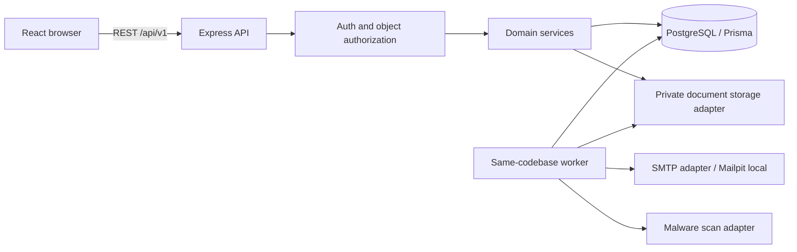

# 06 · System Architecture

Status: proposed implementation baseline; implementation requires separate human approval.

## Modular monolith and runtime boundaries
One npm workspace, `apps/web`, `apps/api`, `packages/contracts`. A separate worker process uses the same API domain services and PostgreSQL; it is a process role of the monolith, not a network microservice. Modules: auth, users, drivers, owners, vehicles, availability, booking, carpool, trips, reviews, notifications, administration, complaints, documents. Each backend module separates router/controller (HTTP), schema (validation), service (authorization/invariants/transactions), repository (Prisma and parameterized SQL). Cross-module writes use exported services and explicit transaction context. No controller contains booking rules; no browser writes database rows.

## Frontend boundary
TanStack Query owns server state, deduplication/invalidation and poll lifecycle; RHF/Zod owns form state; a small in-memory auth store owns access token; role context is UI preference. React Router lazy route modules enforce authenticated/role navigation; backend remains authoritative. Shared contracts contain safe DTOs/Zod schemas (no Prisma runtime or private fields imported into web). One fetch client handles envelope errors, request IDs, credentials for auth only, single refresh+one retry; no uncontrolled mutation retries.

## Consistency and worker design
Database outbox events committed with each domain mutation. Worker claims batches with FOR UPDATE SKIP LOCKED using expiring leases, then processes outside claim transaction. Unique event/recipient delivery keys make in-app effects repeat safe. Email uses provider-message idempotency if available; otherwise at-least-once duplicates explicitly accepted. A worker restart resumes lease-expired work. PostgreSQL job_leases ensures one scheduled expiry/reconciliation job instance. Booking holds and joins are governed by DB time checks regardless of worker lag.

## Storage and adapters
Private StorageAdapter interface supports putQuarantined, scanRead, promoteClean, authorizedRead, retire, removeOrphan. Local disk outside web root for dev, private object-store bucket for production. ScanAdapter uses real malware scanning (ClamAV-compatible) and fails closed while unavailable; dev scanner container runs same flow, no fake CLEAN status. Images re-encoded/metadata stripped. MailAdapter uses Amazon SES through its SMTP endpoint as the concrete production provider and Mailpit as local/test sink; SES credentials/verified sender and delivery configured before production readiness. Auth email sensitive payload encrypted at rest in restricted outbox until sent then scrubbed.

## Database and ORM
Use a supported Prisma schema/Migrate workflow pinned explicitly in Phase01 after checking current official compatibility for the chosen Node/PostgreSQL versions. Record exact CLI commands and test custom SQL migrations before code depends on them. Changing the selected major ORM/migration interface later requires a reviewed ADR. PostgreSQL17 baseline; require btree_gist support on target host. Resource exclusion constraints, row locks and partial indexes require reviewed SQL inside Prisma migrations; schema introspection must not drop them. No parallel Knex migrations.

## Configuration and operations
One API origin with web reverse proxy in staging/prod simplifies secure auth cookies. Compose runs PostgreSQL, Mailpit, scanner and optionally API/worker/web. Backend env validated before startup. Structured logs/metrics expose outbox age, dead letters, expired jobs, auth denial counts, reservation conflicts, overrun incidents. Process health does not imply DB readiness. Run migrations as one release job with DDL role; runtime DB role cannot alter schema or update/delete audit/history.

## Alternatives and rationale
Microservices add distributed inventory consistency without required scale; modular monolith keeps atomic dual-resource/seat/audit events. Redis not required initially: DB-backed throttling/job leases supports API replicas without process-local security gaps. No real-time socket required:30s visible-tab notifications polling is sufficient. No route/geocoding provider: city catalogue and manual notes meet explicit scope. See [20 architecture-decisions](20-architecture-decisions.md).
