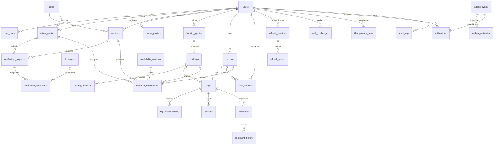

# 07 · Database Design

Status: proposed implementation baseline; implementation requires separate human approval.

## Conventions and relationships
All unspecified columns are NOT NULL. `?` marks nullable, `FK table.column` is explicit reference. Every table includes `created_at timestamptz NOT NULL DEFAULT now()`; mutable tables also include `updated_at timestamptz NOT NULL DEFAULT now()` maintained by DB trigger or explicit Prisma writes tested for all paths. Immutable histories/events/quotes/join snapshot rows omit updated_at. UUID PKs generated cryptographically on server. Foreign keys default ON DELETE RESTRICT, ON UPDATE RESTRICT; there is no history-erasing cascade. All FK columns indexed unless covered by listed composite PK/index. CHECK-constrained text enums match API values; Prisma maps snake_case SQL to camelCase DTOs. Money uses bigint SQL (safe bounded integer JSON values); API caps each stored amount at100000000minor units and serializes validated safe integer Numbers. Reports use safe-range checks or decimal strings if range ever exceeds JS precision; v1 contract uses bounded int64 numeric outputs.

driver_profiles.user_id and owner_profiles.user_id reference users; roles are separate qualification gates. Vehicle ownership is immutable. Verification requests attach exactly one typed subject and immutable document snapshot. A booking quote is immutable and at most one booking consumes it. A trip belongs to exactly one booking/carpool; do not add cyclic parent trip_id columns. Trip IDs in DTOs come from the unique child query. Reservation rows refer to one source and one resource. This typed structure avoids unenforced polymorphic resource IDs. Outbox/audit aggregate IDs intentionally use typed service-validated references so historical events can survive retention boundaries.

## Entity dictionary
### `cities`
| Column declaration | Meaning |
|---|---|
| `id uuid PK` | Primary/foreign key or domain data; type, nullability and default shown explicitly |
| `name varchar(80)` | Primary/foreign key or domain data; type, nullability and default shown explicitly |
| `region varchar(80)` | Primary/foreign key or domain data; type, nullability and default shown explicitly |
| `country char(2)` | Primary/foreign key or domain data; type, nullability and default shown explicitly |
| `timezone varchar(60)` | Primary/foreign key or domain data; type, nullability and default shown explicitly |
| `active boolean DEFAULT true` | Primary/foreign key or domain data; type, nullability and default shown explicitly |

**Constraints:** UNIQUE(country,region,name); valid IANA timezone via seeded allowlist.

**Indexes:** (active,name).

**Deletion/ownership:** Reference city keys RESTRICT; inactive cities preserved.

### `users`
| Column declaration | Meaning |
|---|---|
| `id uuid PK` | Primary/foreign key or domain data; type, nullability and default shown explicitly |
| `email varchar(254)` | Primary/foreign key or domain data; type, nullability and default shown explicitly |
| `display_name varchar(80)` | Primary/foreign key or domain data; type, nullability and default shown explicitly |
| `phone varchar(16)?` | Primary/foreign key or domain data; type, nullability and default shown explicitly |
| `password_hash text` | Primary/foreign key or domain data; type, nullability and default shown explicitly |
| `email_verified_at timestamptz?` | Primary/foreign key or domain data; type, nullability and default shown explicitly |
| `status varchar(16) DEFAULT ACTIVE` | Primary/foreign key or domain data; type, nullability and default shown explicitly |
| `token_version integer DEFAULT 1` | Primary/foreign key or domain data; type, nullability and default shown explicitly |
| `suspended_at timestamptz?` | Primary/foreign key or domain data; type, nullability and default shown explicitly |
| `suspension_reason text?` | Primary/foreign key or domain data; type, nullability and default shown explicitly |
| `version integer DEFAULT 1` | Primary/foreign key or domain data; type, nullability and default shown explicitly |

**Constraints:** UNIQUE(email); email=lower(trim(email)); status ACTIVE|SUSPENDED; token_version>0.

**Indexes:** (status,created_at DESC).

**Deletion/ownership:** Identity retained; no physical deletion in v1.

### `user_roles`
| Column declaration | Meaning |
|---|---|
| `user_id uuid FK users.id` | Primary/foreign key or domain data; type, nullability and default shown explicitly |
| `role varchar(16)` | Primary/foreign key or domain data; type, nullability and default shown explicitly |
| `granted_by uuid? FK users.id` | Primary/foreign key or domain data; type, nullability and default shown explicitly |
| `granted_at timestamptz DEFAULT now()` | Primary/foreign key or domain data; type, nullability and default shown explicitly |

**Constraints:** PK(user_id,role); role PASSENGER|DRIVER|OWNER|ADMIN.

**Indexes:** (role,user_id).

**Deletion/ownership:** Both user FKs RESTRICT; operator grants audited.

### `owner_profiles`
| Column declaration | Meaning |
|---|---|
| `user_id uuid PK FK users.id` | Primary/foreign key or domain data; type, nullability and default shown explicitly |
| `display_name varchar(80)` | Primary/foreign key or domain data; type, nullability and default shown explicitly |
| `contact_phone varchar(16)` | Primary/foreign key or domain data; type, nullability and default shown explicitly |
| `version integer DEFAULT 1` | Primary/foreign key or domain data; type, nullability and default shown explicitly |

**Constraints:** Contact phone E.164 validated; OWNER relation enforced service.

**Indexes:** (user_id).

**Deletion/ownership:** Owner immutable; RESTRICT identity deletion.

### `driver_profiles`
| Column declaration | Meaning |
|---|---|
| `id uuid PK` | Primary/foreign key or domain data; type, nullability and default shown explicitly |
| `user_id uuid FK users.id` | Primary/foreign key or domain data; type, nullability and default shown explicitly |
| `license_number_ciphertext text?` | Primary/foreign key or domain data; type, nullability and default shown explicitly |
| `license_number_digest char(64)?` | Primary/foreign key or domain data; type, nullability and default shown explicitly |
| `license_country char(2)?` | Primary/foreign key or domain data; type, nullability and default shown explicitly |
| `license_expires_on date?` | Primary/foreign key or domain data; type, nullability and default shown explicitly |
| `city_id uuid? FK cities.id` | Primary/foreign key or domain data; type, nullability and default shown explicitly |
| `hourly_rate_minor integer?` | Primary/foreign key or domain data; type, nullability and default shown explicitly |
| `verification_status varchar(16) DEFAULT DRAFT` | Primary/foreign key or domain data; type, nullability and default shown explicitly |
| `current_verification_id uuid? FK verification_requests.id` | Primary/foreign key or domain data; type, nullability and default shown explicitly |
| `accepting_bookings boolean DEFAULT false` | Primary/foreign key or domain data; type, nullability and default shown explicitly |
| `version integer DEFAULT 1` | Primary/foreign key or domain data; type, nullability and default shown explicitly |

**Constraints:** UNIQUE(user_id); UNIQUE(license_country,license_number_digest); rate>0 when set; approved implies required fields present; verification status enum.

**Indexes:** (city_id,verification_status,accepting_bookings); (license_expires_on).

**Deletion/ownership:** Draft nullable until submission; user/city/current revision RESTRICT; immutable user owner.

### `vehicles`
| Column declaration | Meaning |
|---|---|
| `id uuid PK` | Primary/foreign key or domain data; type, nullability and default shown explicitly |
| `owner_id uuid FK users.id` | Primary/foreign key or domain data; type, nullability and default shown explicitly |
| `registration_number_ciphertext text` | Primary/foreign key or domain data; type, nullability and default shown explicitly |
| `registration_number_digest char(64)` | Primary/foreign key or domain data; type, nullability and default shown explicitly |
| `make varchar(60)` | Primary/foreign key or domain data; type, nullability and default shown explicitly |
| `model varchar(60)` | Primary/foreign key or domain data; type, nullability and default shown explicitly |
| `year smallint` | Primary/foreign key or domain data; type, nullability and default shown explicitly |
| `category varchar(20)` | Primary/foreign key or domain data; type, nullability and default shown explicitly |
| `seats smallint` | Primary/foreign key or domain data; type, nullability and default shown explicitly |
| `transmission varchar(16)` | Primary/foreign key or domain data; type, nullability and default shown explicitly |
| `fuel_type varchar(16)` | Primary/foreign key or domain data; type, nullability and default shown explicitly |
| `city_id uuid FK cities.id` | Primary/foreign key or domain data; type, nullability and default shown explicitly |
| `hourly_rate_minor integer` | Primary/foreign key or domain data; type, nullability and default shown explicitly |
| `description text?` | Primary/foreign key or domain data; type, nullability and default shown explicitly |
| `verification_status varchar(16) DEFAULT DRAFT` | Primary/foreign key or domain data; type, nullability and default shown explicitly |
| `current_verification_id uuid? FK verification_requests.id` | Primary/foreign key or domain data; type, nullability and default shown explicitly |
| `listed boolean DEFAULT false` | Primary/foreign key or domain data; type, nullability and default shown explicitly |
| `archived_at timestamptz?` | Primary/foreign key or domain data; type, nullability and default shown explicitly |
| `version integer DEFAULT 1` | Primary/foreign key or domain data; type, nullability and default shown explicitly |

**Constraints:** UNIQUE(registration_number_digest); seats BETWEEN2 AND12; year1990..2100; rate>0; enums per contract.

**Indexes:** (owner_id,archived_at); (city_id,category,verification_status,listed); (current_verification_id).

**Deletion/ownership:** RESTRICT owner/city/current revision; archive not delete; owner_id immutable.

### `documents`
| Column declaration | Meaning |
|---|---|
| `id uuid PK` | Primary/foreign key or domain data; type, nullability and default shown explicitly |
| `uploader_id uuid FK users.id` | Primary/foreign key or domain data; type, nullability and default shown explicitly |
| `driver_id uuid? FK driver_profiles.id` | Primary/foreign key or domain data; type, nullability and default shown explicitly |
| `vehicle_id uuid? FK vehicles.id` | Primary/foreign key or domain data; type, nullability and default shown explicitly |
| `kind varchar(20)` | Primary/foreign key or domain data; type, nullability and default shown explicitly |
| `object_key text` | Primary/foreign key or domain data; type, nullability and default shown explicitly |
| `content_type varchar(80)` | Primary/foreign key or domain data; type, nullability and default shown explicitly |
| `byte_size integer` | Primary/foreign key or domain data; type, nullability and default shown explicitly |
| `sha256 char(64)` | Primary/foreign key or domain data; type, nullability and default shown explicitly |
| `scan_status varchar(16) DEFAULT PENDING` | Primary/foreign key or domain data; type, nullability and default shown explicitly |
| `expires_on date?` | Primary/foreign key or domain data; type, nullability and default shown explicitly |
| `retired_at timestamptz?` | Primary/foreign key or domain data; type, nullability and default shown explicitly |
| `encryption_key_version varchar(40)?` | Primary/foreign key or domain data; type, nullability and default shown explicitly |

**Constraints:** Exactly one driver_id/vehicle_id; UNIQUE(object_key); size1..5242880; kind/scan enums; LICENSE only driver; others only vehicle.

**Indexes:** (driver_id,kind); (vehicle_id,kind); (scan_status,created_at).

**Deletion/ownership:** RESTRICT parent/uploader; binary private; retire before physical cleanup; audit sensitive reads.

### `verification_requests`
| Column declaration | Meaning |
|---|---|
| `id uuid PK` | Primary/foreign key or domain data; type, nullability and default shown explicitly |
| `driver_id uuid? FK driver_profiles.id` | Primary/foreign key or domain data; type, nullability and default shown explicitly |
| `vehicle_id uuid? FK vehicles.id` | Primary/foreign key or domain data; type, nullability and default shown explicitly |
| `revision integer` | Primary/foreign key or domain data; type, nullability and default shown explicitly |
| `subject_version integer` | Primary/foreign key or domain data; type, nullability and default shown explicitly |
| `status varchar(16) DEFAULT PENDING` | Primary/foreign key or domain data; type, nullability and default shown explicitly |
| `submitted_by uuid FK users.id` | Primary/foreign key or domain data; type, nullability and default shown explicitly |
| `decided_by uuid? FK users.id` | Primary/foreign key or domain data; type, nullability and default shown explicitly |
| `submitted_at timestamptz` | Primary/foreign key or domain data; type, nullability and default shown explicitly |
| `decided_at timestamptz?` | Primary/foreign key or domain data; type, nullability and default shown explicitly |
| `reason text?` | Primary/foreign key or domain data; type, nullability and default shown explicitly |
| `version integer DEFAULT 1` | Primary/foreign key or domain data; type, nullability and default shown explicitly |

**Constraints:** Exactly one subject; UNIQUE(driver_id,revision), UNIQUE(vehicle_id,revision); partial UNIQUE(subject) WHERE status=PENDING; decided actor != submitter; allowed enum.

**Indexes:** (status,submitted_at); (driver_id,revision DESC); (vehicle_id,revision DESC).

**Deletion/ownership:** All references RESTRICT; snapshot immutable except decision/status; current revision linked after create.

### `verification_documents`
| Column declaration | Meaning |
|---|---|
| `verification_id uuid FK verification_requests.id` | Primary/foreign key or domain data; type, nullability and default shown explicitly |
| `document_id uuid FK documents.id` | Primary/foreign key or domain data; type, nullability and default shown explicitly |

**Constraints:** PK(verification_id,document_id); same subject validated transaction.

**Indexes:** (document_id).

**Deletion/ownership:** RESTRICT both; immutable snapshot; no cascade erase.

### `availability_windows`
| Column declaration | Meaning |
|---|---|
| `id uuid PK` | Primary/foreign key or domain data; type, nullability and default shown explicitly |
| `driver_id uuid? FK driver_profiles.id` | Primary/foreign key or domain data; type, nullability and default shown explicitly |
| `vehicle_id uuid? FK vehicles.id` | Primary/foreign key or domain data; type, nullability and default shown explicitly |
| `kind varchar(16)` | Primary/foreign key or domain data; type, nullability and default shown explicitly |
| `starts_at timestamptz` | Primary/foreign key or domain data; type, nullability and default shown explicitly |
| `ends_at timestamptz` | Primary/foreign key or domain data; type, nullability and default shown explicitly |
| `removed_at timestamptz?` | Primary/foreign key or domain data; type, nullability and default shown explicitly |
| `version integer DEFAULT 1` | Primary/foreign key or domain data; type, nullability and default shown explicitly |

**Constraints:** Exactly one resource; starts_at<ends_at; kind AVAILABLE|BLOCKED.

**Indexes:** (driver_id,starts_at,ends_at) WHERE removed_at IS NULL; (vehicle_id,starts_at,ends_at) WHERE removed_at IS NULL.

**Deletion/ownership:** RESTRICT resources; remove/retire with reservation release; AVAILABLE windows not themselves holds.

### `booking_quotes`
| Column declaration | Meaning |
|---|---|
| `id uuid PK` | Primary/foreign key or domain data; type, nullability and default shown explicitly |
| `requester_id uuid FK users.id` | Primary/foreign key or domain data; type, nullability and default shown explicitly |
| `service varchar(24)` | Primary/foreign key or domain data; type, nullability and default shown explicitly |
| `vehicle_id uuid FK vehicles.id` | Primary/foreign key or domain data; type, nullability and default shown explicitly |
| `driver_id uuid FK driver_profiles.id` | Primary/foreign key or domain data; type, nullability and default shown explicitly |
| `vehicle_version integer` | Primary/foreign key or domain data; type, nullability and default shown explicitly |
| `driver_version integer` | Primary/foreign key or domain data; type, nullability and default shown explicitly |
| `starts_at timestamptz` | Primary/foreign key or domain data; type, nullability and default shown explicitly |
| `ends_at timestamptz` | Primary/foreign key or domain data; type, nullability and default shown explicitly |
| `origin_city_id uuid FK cities.id` | Primary/foreign key or domain data; type, nullability and default shown explicitly |
| `destination_city_id uuid FK cities.id` | Primary/foreign key or domain data; type, nullability and default shown explicitly |
| `passengers smallint` | Primary/foreign key or domain data; type, nullability and default shown explicitly |
| `billable_hours integer` | Primary/foreign key or domain data; type, nullability and default shown explicitly |
| `vehicle_rate_minor integer` | Primary/foreign key or domain data; type, nullability and default shown explicitly |
| `driver_rate_minor integer` | Primary/foreign key or domain data; type, nullability and default shown explicitly |
| `vehicle_subtotal_minor bigint` | Primary/foreign key or domain data; type, nullability and default shown explicitly |
| `driver_subtotal_minor bigint` | Primary/foreign key or domain data; type, nullability and default shown explicitly |
| `total_minor bigint` | Primary/foreign key or domain data; type, nullability and default shown explicitly |
| `currency char(3) DEFAULT INR` | Primary/foreign key or domain data; type, nullability and default shown explicitly |
| `expires_at timestamptz` | Primary/foreign key or domain data; type, nullability and default shown explicitly |

**Constraints:** Time order; values>=0; total=sum subtotals; service enum; passengers1..11; currency=INR.

**Indexes:** (requester_id,created_at DESC); (expires_at).

**Deletion/ownership:** RESTRICT all references; immutable quote retained with booking.

### `bookings`
| Column declaration | Meaning |
|---|---|
| `id uuid PK` | Primary/foreign key or domain data; type, nullability and default shown explicitly |
| `quote_id uuid FK booking_quotes.id` | Primary/foreign key or domain data; type, nullability and default shown explicitly |
| `passenger_id uuid FK users.id` | Primary/foreign key or domain data; type, nullability and default shown explicitly |
| `vehicle_id uuid FK vehicles.id` | Primary/foreign key or domain data; type, nullability and default shown explicitly |
| `driver_id uuid FK driver_profiles.id` | Primary/foreign key or domain data; type, nullability and default shown explicitly |
| `service varchar(24)` | Primary/foreign key or domain data; type, nullability and default shown explicitly |
| `status varchar(16) DEFAULT PENDING` | Primary/foreign key or domain data; type, nullability and default shown explicitly |
| `starts_at timestamptz` | Primary/foreign key or domain data; type, nullability and default shown explicitly |
| `ends_at timestamptz` | Primary/foreign key or domain data; type, nullability and default shown explicitly |
| `total_minor bigint` | Primary/foreign key or domain data; type, nullability and default shown explicitly |
| `currency char(3) DEFAULT INR` | Primary/foreign key or domain data; type, nullability and default shown explicitly |
| `expires_at timestamptz` | Primary/foreign key or domain data; type, nullability and default shown explicitly |
| `cancel_reason text?` | Primary/foreign key or domain data; type, nullability and default shown explicitly |
| `version integer DEFAULT 1` | Primary/foreign key or domain data; type, nullability and default shown explicitly |

**Constraints:** UNIQUE(quote_id); start<end; total>=0; status/service enums; no payment processing column.

**Indexes:** (passenger_id,created_at DESC); (driver_id,status,starts_at); (vehicle_id,status,starts_at); (status,expires_at).

**Deletion/ownership:** RESTRICT references; assigned resource snapshot historical; only pending driver replacement allowed.

### `booking_decisions`
| Column declaration | Meaning |
|---|---|
| `id uuid PK` | Primary/foreign key or domain data; type, nullability and default shown explicitly |
| `booking_id uuid FK bookings.id` | Primary/foreign key or domain data; type, nullability and default shown explicitly |
| `provider_id uuid FK users.id` | Primary/foreign key or domain data; type, nullability and default shown explicitly |
| `kind varchar(16)` | Primary/foreign key or domain data; type, nullability and default shown explicitly |
| `status varchar(16) DEFAULT PENDING` | Primary/foreign key or domain data; type, nullability and default shown explicitly |
| `decided_at timestamptz?` | Primary/foreign key or domain data; type, nullability and default shown explicitly |
| `reason text?` | Primary/foreign key or domain data; type, nullability and default shown explicitly |
| `superseded_at timestamptz?` | Primary/foreign key or domain data; type, nullability and default shown explicitly |

**Constraints:** Partial UNIQUE(booking_id,kind) WHERE superseded_at IS NULL; kind OWNER|DRIVER; status PENDING|ACCEPTED|REJECTED.

**Indexes:** (provider_id,status); (booking_id).

**Deletion/ownership:** RESTRICT; superseded driver consents retained.

### `carpools`
| Column declaration | Meaning |
|---|---|
| `id uuid PK` | Primary/foreign key or domain data; type, nullability and default shown explicitly |
| `host_id uuid FK users.id` | Primary/foreign key or domain data; type, nullability and default shown explicitly |
| `driver_id uuid FK driver_profiles.id` | Primary/foreign key or domain data; type, nullability and default shown explicitly |
| `vehicle_id uuid FK vehicles.id` | Primary/foreign key or domain data; type, nullability and default shown explicitly |
| `origin_city_id uuid FK cities.id` | Primary/foreign key or domain data; type, nullability and default shown explicitly |
| `destination_city_id uuid FK cities.id` | Primary/foreign key or domain data; type, nullability and default shown explicitly |
| `pickup_note varchar(300)` | Primary/foreign key or domain data; type, nullability and default shown explicitly |
| `dropoff_note varchar(300)` | Primary/foreign key or domain data; type, nullability and default shown explicitly |
| `starts_at timestamptz` | Primary/foreign key or domain data; type, nullability and default shown explicitly |
| `ends_at timestamptz` | Primary/foreign key or domain data; type, nullability and default shown explicitly |
| `seats_offered smallint` | Primary/foreign key or domain data; type, nullability and default shown explicitly |
| `confirmed_seats smallint DEFAULT 0` | Primary/foreign key or domain data; type, nullability and default shown explicitly |
| `price_per_seat_minor integer` | Primary/foreign key or domain data; type, nullability and default shown explicitly |
| `currency char(3) DEFAULT INR` | Primary/foreign key or domain data; type, nullability and default shown explicitly |
| `join_mode varchar(16)` | Primary/foreign key or domain data; type, nullability and default shown explicitly |
| `status varchar(16) DEFAULT DRAFT` | Primary/foreign key or domain data; type, nullability and default shown explicitly |
| `published_at timestamptz?` | Primary/foreign key or domain data; type, nullability and default shown explicitly |
| `version integer DEFAULT 1` | Primary/foreign key or domain data; type, nullability and default shown explicitly |

**Constraints:** origin!=destination; start<end; offered1..11; 0<=confirmed<=offered; price>=0; enums per contract.

**Indexes:** (origin_city_id,destination_city_id,starts_at) WHERE status=PUBLISHED; (host_id,starts_at DESC); (status,starts_at).

**Deletion/ownership:** RESTRICT references; no physical delete; parent fields immutable after publication.

### `seat_requests`
| Column declaration | Meaning |
|---|---|
| `id uuid PK` | Primary/foreign key or domain data; type, nullability and default shown explicitly |
| `carpool_id uuid FK carpools.id` | Primary/foreign key or domain data; type, nullability and default shown explicitly |
| `passenger_id uuid FK users.id` | Primary/foreign key or domain data; type, nullability and default shown explicitly |
| `seats smallint` | Primary/foreign key or domain data; type, nullability and default shown explicitly |
| `status varchar(16)` | Primary/foreign key or domain data; type, nullability and default shown explicitly |
| `price_per_seat_minor integer` | Primary/foreign key or domain data; type, nullability and default shown explicitly |
| `message varchar(500)?` | Primary/foreign key or domain data; type, nullability and default shown explicitly |
| `reason text?` | Primary/foreign key or domain data; type, nullability and default shown explicitly |
| `version integer DEFAULT 1` | Primary/foreign key or domain data; type, nullability and default shown explicitly |

**Constraints:** seats1..11; price>=0; partial UNIQUE(carpool_id,passenger_id) WHERE status IN(PENDING,ACCEPTED); status enum.

**Indexes:** (passenger_id,created_at DESC); (carpool_id,status).

**Deletion/ownership:** RESTRICT; retain terminal requests; sum accepted seats under carpool lock.

### `trips`
| Column declaration | Meaning |
|---|---|
| `id uuid PK` | Primary/foreign key or domain data; type, nullability and default shown explicitly |
| `booking_id uuid? FK bookings.id` | Primary/foreign key or domain data; type, nullability and default shown explicitly |
| `carpool_id uuid? FK carpools.id` | Primary/foreign key or domain data; type, nullability and default shown explicitly |
| `driver_id uuid FK driver_profiles.id` | Primary/foreign key or domain data; type, nullability and default shown explicitly |
| `vehicle_id uuid FK vehicles.id` | Primary/foreign key or domain data; type, nullability and default shown explicitly |
| `status varchar(16) DEFAULT SCHEDULED` | Primary/foreign key or domain data; type, nullability and default shown explicitly |
| `starts_at timestamptz` | Primary/foreign key or domain data; type, nullability and default shown explicitly |
| `ends_at timestamptz` | Primary/foreign key or domain data; type, nullability and default shown explicitly |
| `started_at timestamptz?` | Primary/foreign key or domain data; type, nullability and default shown explicitly |
| `completed_at timestamptz?` | Primary/foreign key or domain data; type, nullability and default shown explicitly |
| `waypoints jsonb DEFAULT []` | Primary/foreign key or domain data; type, nullability and default shown explicitly |
| `waypoint_index smallint DEFAULT 0` | Primary/foreign key or domain data; type, nullability and default shown explicitly |
| `incident_flag boolean DEFAULT false` | Primary/foreign key or domain data; type, nullability and default shown explicitly |
| `version integer DEFAULT 1` | Primary/foreign key or domain data; type, nullability and default shown explicitly |

**Constraints:** Exactly one parent; UNIQUE(booking_id); UNIQUE(carpool_id); valid status; start<end; waypoint_index0..jsonb_array_length(waypoints); max8 waypoints.

**Indexes:** (driver_id,status,starts_at); (vehicle_id,status,starts_at); (status,ends_at).

**Deletion/ownership:** RESTRICT all; driver snapshot follows approved pending reassignment only; no live GPS columns.

### `resource_reservations`
| Column declaration | Meaning |
|---|---|
| `id uuid PK` | Primary/foreign key or domain data; type, nullability and default shown explicitly |
| `driver_id uuid? FK driver_profiles.id` | Primary/foreign key or domain data; type, nullability and default shown explicitly |
| `vehicle_id uuid? FK vehicles.id` | Primary/foreign key or domain data; type, nullability and default shown explicitly |
| `booking_id uuid? FK bookings.id` | Primary/foreign key or domain data; type, nullability and default shown explicitly |
| `carpool_id uuid? FK carpools.id` | Primary/foreign key or domain data; type, nullability and default shown explicitly |
| `availability_block_id uuid? FK availability_windows.id` | Primary/foreign key or domain data; type, nullability and default shown explicitly |
| `starts_at timestamptz` | Primary/foreign key or domain data; type, nullability and default shown explicitly |
| `ends_at timestamptz` | Primary/foreign key or domain data; type, nullability and default shown explicitly |
| `reserved_range tstzrange GENERATED ALWAYS AS tstzrange(starts_at,ends_at,'[)') STORED` | Primary/foreign key or domain data; type, nullability and default shown explicitly |
| `released_at timestamptz?` | Primary/foreign key or domain data; type, nullability and default shown explicitly |

**Constraints:** Exactly one resource; exactly one source; start<end; partial GiST exclusion(driver_id WITH =,reserved_range WITH &&) WHERE released_at IS NULL AND driver_id IS NOT NULL; equivalent vehicle constraint.

**Indexes:** GiST constraints indexes; (booking_id); (carpool_id); (availability_block_id).

**Deletion/ownership:** RESTRICT source/resources; release not delete; resource ids never client supplied separately from domain.

### `trip_status_history`
| Column declaration | Meaning |
|---|---|
| `id uuid PK` | Primary/foreign key or domain data; type, nullability and default shown explicitly |
| `trip_id uuid FK trips.id` | Primary/foreign key or domain data; type, nullability and default shown explicitly |
| `from_status varchar(16)?` | Primary/foreign key or domain data; type, nullability and default shown explicitly |
| `to_status varchar(16)` | Primary/foreign key or domain data; type, nullability and default shown explicitly |
| `actor_id uuid? FK users.id` | Primary/foreign key or domain data; type, nullability and default shown explicitly |
| `actor_type varchar(16)` | Primary/foreign key or domain data; type, nullability and default shown explicitly |
| `reason text?` | Primary/foreign key or domain data; type, nullability and default shown explicitly |
| `metadata jsonb DEFAULT {}` | Primary/foreign key or domain data; type, nullability and default shown explicitly |
| `trip_version integer` | Primary/foreign key or domain data; type, nullability and default shown explicitly |
| `request_id varchar(80)` | Primary/foreign key or domain data; type, nullability and default shown explicitly |

**Constraints:** UNIQUE(trip_id,trip_version); actor_type USER|WORKER; append-only.

**Indexes:** (trip_id,created_at,id).

**Deletion/ownership:** RESTRICT; runtime cannot update/delete; null actor only system job.

### `refresh_sessions`
| Column declaration | Meaning |
|---|---|
| `id uuid PK` | Primary/foreign key or domain data; type, nullability and default shown explicitly |
| `user_id uuid FK users.id` | Primary/foreign key or domain data; type, nullability and default shown explicitly |
| `absolute_expires_at timestamptz` | Primary/foreign key or domain data; type, nullability and default shown explicitly |
| `revoked_at timestamptz?` | Primary/foreign key or domain data; type, nullability and default shown explicitly |
| `revocation_reason varchar(80)?` | Primary/foreign key or domain data; type, nullability and default shown explicitly |
| `user_agent_digest char(64)?` | Primary/foreign key or domain data; type, nullability and default shown explicitly |

**Constraints:** absolute expiry<=created+30d; family sid in JWT.

**Indexes:** (user_id,revoked_at); (absolute_expires_at).

**Deletion/ownership:** RESTRICT; audit minimal session metadata; no raw tokens.

### `refresh_tokens`
| Column declaration | Meaning |
|---|---|
| `id uuid PK` | Primary/foreign key or domain data; type, nullability and default shown explicitly |
| `session_id uuid FK refresh_sessions.id` | Primary/foreign key or domain data; type, nullability and default shown explicitly |
| `token_hash char(64)` | Primary/foreign key or domain data; type, nullability and default shown explicitly |
| `parent_token_id uuid? FK refresh_tokens.id` | Primary/foreign key or domain data; type, nullability and default shown explicitly |
| `expires_at timestamptz` | Primary/foreign key or domain data; type, nullability and default shown explicitly |
| `consumed_at timestamptz?` | Primary/foreign key or domain data; type, nullability and default shown explicitly |
| `revoked_at timestamptz?` | Primary/foreign key or domain data; type, nullability and default shown explicitly |

**Constraints:** UNIQUE(token_hash); UNIQUE(parent_token_id); expiry<=session absolute expiry; token hash SHA256 of256bit random.

**Indexes:** (session_id); (expires_at).

**Deletion/ownership:** RESTRICT; retain consumed hashes through family expiry+7d.

### `auth_challenges`
| Column declaration | Meaning |
|---|---|
| `id uuid PK` | Primary/foreign key or domain data; type, nullability and default shown explicitly |
| `user_id uuid FK users.id` | Primary/foreign key or domain data; type, nullability and default shown explicitly |
| `purpose varchar(24)` | Primary/foreign key or domain data; type, nullability and default shown explicitly |
| `secret_hash char(64)` | Primary/foreign key or domain data; type, nullability and default shown explicitly |
| `expires_at timestamptz` | Primary/foreign key or domain data; type, nullability and default shown explicitly |
| `attempts smallint DEFAULT 0` | Primary/foreign key or domain data; type, nullability and default shown explicitly |
| `consumed_at timestamptz?` | Primary/foreign key or domain data; type, nullability and default shown explicitly |
| `invalidated_at timestamptz?` | Primary/foreign key or domain data; type, nullability and default shown explicitly |
| `resend_after timestamptz` | Primary/foreign key or domain data; type, nullability and default shown explicitly |

**Constraints:** purpose VERIFY_EMAIL|RESET_PASSWORD; attempts0..5; partial UNIQUE(user_id,purpose) WHERE consumed_at IS NULL AND invalidated_at IS NULL.

**Indexes:** (expires_at); (user_id,purpose,created_at DESC).

**Deletion/ownership:** RESTRICT user; OTP keyed-HMAC, reset SHA256; no raw secret.

### `idempotency_keys`
| Column declaration | Meaning |
|---|---|
| `id uuid PK` | Primary/foreign key or domain data; type, nullability and default shown explicitly |
| `user_id uuid FK users.id` | Primary/foreign key or domain data; type, nullability and default shown explicitly |
| `operation varchar(80)` | Primary/foreign key or domain data; type, nullability and default shown explicitly |
| `key varchar(128)` | Primary/foreign key or domain data; type, nullability and default shown explicitly |
| `request_hash char(64)` | Primary/foreign key or domain data; type, nullability and default shown explicitly |
| `response_status smallint` | Primary/foreign key or domain data; type, nullability and default shown explicitly |
| `response_body jsonb` | Primary/foreign key or domain data; type, nullability and default shown explicitly |
| `expires_at timestamptz` | Primary/foreign key or domain data; type, nullability and default shown explicitly |

**Constraints:** UNIQUE(user_id,operation,key); completed response only; expired key reclaimed atomically.

**Indexes:** (expires_at).

**Deletion/ownership:** RESTRICT; no auth secrets in replay body; same transaction as resource creation.

### `outbox_events`
| Column declaration | Meaning |
|---|---|
| `id uuid PK` | Primary/foreign key or domain data; type, nullability and default shown explicitly |
| `event_type varchar(80)` | Primary/foreign key or domain data; type, nullability and default shown explicitly |
| `aggregate_type varchar(40)` | Primary/foreign key or domain data; type, nullability and default shown explicitly |
| `aggregate_id uuid` | Primary/foreign key or domain data; type, nullability and default shown explicitly |
| `aggregate_version integer` | Primary/foreign key or domain data; type, nullability and default shown explicitly |
| `payload jsonb` | Primary/foreign key or domain data; type, nullability and default shown explicitly |
| `sensitive_payload_ciphertext text?` | Primary/foreign key or domain data; type, nullability and default shown explicitly |
| `occurred_at timestamptz` | Primary/foreign key or domain data; type, nullability and default shown explicitly |
| `available_at timestamptz` | Primary/foreign key or domain data; type, nullability and default shown explicitly |
| `attempts integer DEFAULT 0` | Primary/foreign key or domain data; type, nullability and default shown explicitly |
| `lease_until timestamptz?` | Primary/foreign key or domain data; type, nullability and default shown explicitly |
| `processed_at timestamptz?` | Primary/foreign key or domain data; type, nullability and default shown explicitly |
| `dead_letter_at timestamptz?` | Primary/foreign key or domain data; type, nullability and default shown explicitly |
| `last_error_code varchar(80)?` | Primary/foreign key or domain data; type, nullability and default shown explicitly |

**Constraints:** UNIQUE(aggregate_type,aggregate_id,event_type,aggregate_version); payload contains safe typed IDs, no raw OTP/token.

**Indexes:** (available_at,occurred_at) WHERE processed_at IS NULL AND dead_letter_at IS NULL.

**Deletion/ownership:** Aggregate reference typed service-validated; no arbitrary FK; durable processing lease; immutable event identity.

### `outbox_deliveries`
| Column declaration | Meaning |
|---|---|
| `id uuid PK` | Primary/foreign key or domain data; type, nullability and default shown explicitly |
| `event_id uuid FK outbox_events.id` | Primary/foreign key or domain data; type, nullability and default shown explicitly |
| `recipient_id uuid FK users.id` | Primary/foreign key or domain data; type, nullability and default shown explicitly |
| `channel varchar(16)` | Primary/foreign key or domain data; type, nullability and default shown explicitly |
| `delivered_at timestamptz?` | Primary/foreign key or domain data; type, nullability and default shown explicitly |
| `provider_message_id varchar(200)?` | Primary/foreign key or domain data; type, nullability and default shown explicitly |
| `attempts integer DEFAULT 0` | Primary/foreign key or domain data; type, nullability and default shown explicitly |

**Constraints:** UNIQUE(event_id,recipient_id,channel); channel IN_APP|EMAIL.

**Indexes:** (event_id,channel,delivered_at).

**Deletion/ownership:** RESTRICT event/recipient; email at-least-once; in-app unique insertion.

### `notifications`
| Column declaration | Meaning |
|---|---|
| `id uuid PK` | Primary/foreign key or domain data; type, nullability and default shown explicitly |
| `event_id uuid FK outbox_events.id` | Primary/foreign key or domain data; type, nullability and default shown explicitly |
| `recipient_id uuid FK users.id` | Primary/foreign key or domain data; type, nullability and default shown explicitly |
| `event_type varchar(80)` | Primary/foreign key or domain data; type, nullability and default shown explicitly |
| `title varchar(160)` | Primary/foreign key or domain data; type, nullability and default shown explicitly |
| `body varchar(500)` | Primary/foreign key or domain data; type, nullability and default shown explicitly |
| `link varchar(300)` | Primary/foreign key or domain data; type, nullability and default shown explicitly |
| `read_at timestamptz?` | Primary/foreign key or domain data; type, nullability and default shown explicitly |

**Constraints:** UNIQUE(event_id,recipient_id); link restricted app-relative route.

**Indexes:** (recipient_id,created_at DESC,id); (recipient_id) WHERE read_at IS NULL.

**Deletion/ownership:** RESTRICT event/user; no private documents embedded.

### `reviews`
| Column declaration | Meaning |
|---|---|
| `id uuid PK` | Primary/foreign key or domain data; type, nullability and default shown explicitly |
| `trip_id uuid FK trips.id` | Primary/foreign key or domain data; type, nullability and default shown explicitly |
| `author_id uuid FK users.id` | Primary/foreign key or domain data; type, nullability and default shown explicitly |
| `driver_id uuid? FK driver_profiles.id` | Primary/foreign key or domain data; type, nullability and default shown explicitly |
| `vehicle_id uuid? FK vehicles.id` | Primary/foreign key or domain data; type, nullability and default shown explicitly |
| `rating smallint` | Primary/foreign key or domain data; type, nullability and default shown explicitly |
| `text varchar(2000)?` | Primary/foreign key or domain data; type, nullability and default shown explicitly |
| `hidden_at timestamptz?` | Primary/foreign key or domain data; type, nullability and default shown explicitly |
| `hidden_by uuid? FK users.id` | Primary/foreign key or domain data; type, nullability and default shown explicitly |
| `hide_reason text?` | Primary/foreign key or domain data; type, nullability and default shown explicitly |

**Constraints:** Exactly one target; rating1..5; UNIQUE(trip_id,author_id,driver_id); UNIQUE(trip_id,author_id,vehicle_id).

**Indexes:** (driver_id,created_at DESC) WHERE hidden_at IS NULL; (vehicle_id,created_at DESC) WHERE hidden_at IS NULL; (author_id,created_at DESC).

**Deletion/ownership:** RESTRICT all; no public author email; mean/count computed from visible rows.

### `complaints`
| Column declaration | Meaning |
|---|---|
| `id uuid PK` | Primary/foreign key or domain data; type, nullability and default shown explicitly |
| `trip_id uuid FK trips.id` | Primary/foreign key or domain data; type, nullability and default shown explicitly |
| `reporter_id uuid FK users.id` | Primary/foreign key or domain data; type, nullability and default shown explicitly |
| `subject varchar(120)` | Primary/foreign key or domain data; type, nullability and default shown explicitly |
| `description varchar(4000)` | Primary/foreign key or domain data; type, nullability and default shown explicitly |
| `status varchar(16) DEFAULT OPEN` | Primary/foreign key or domain data; type, nullability and default shown explicitly |
| `resolution varchar(2000)?` | Primary/foreign key or domain data; type, nullability and default shown explicitly |
| `resolved_by uuid? FK users.id` | Primary/foreign key or domain data; type, nullability and default shown explicitly |
| `resolved_at timestamptz?` | Primary/foreign key or domain data; type, nullability and default shown explicitly |
| `version integer DEFAULT 1` | Primary/foreign key or domain data; type, nullability and default shown explicitly |

**Constraints:** status OPEN|IN_REVIEW|RESOLVED|DISMISSED; terminal requires resolution/actor/date.

**Indexes:** (status,created_at); (reporter_id,created_at DESC); (trip_id).

**Deletion/ownership:** RESTRICT all; no delete endpoint.

### `complaint_history`
| Column declaration | Meaning |
|---|---|
| `id uuid PK` | Primary/foreign key or domain data; type, nullability and default shown explicitly |
| `complaint_id uuid FK complaints.id` | Primary/foreign key or domain data; type, nullability and default shown explicitly |
| `actor_id uuid FK users.id` | Primary/foreign key or domain data; type, nullability and default shown explicitly |
| `from_status varchar(16)` | Primary/foreign key or domain data; type, nullability and default shown explicitly |
| `to_status varchar(16)` | Primary/foreign key or domain data; type, nullability and default shown explicitly |
| `resolution varchar(2000)` | Primary/foreign key or domain data; type, nullability and default shown explicitly |
| `version integer` | Primary/foreign key or domain data; type, nullability and default shown explicitly |

**Constraints:** UNIQUE(complaint_id,version); append-only.

**Indexes:** (complaint_id,created_at).

**Deletion/ownership:** RESTRICT; audit trail separate from current complaint.

### `audit_logs`
| Column declaration | Meaning |
|---|---|
| `id uuid PK` | Primary/foreign key or domain data; type, nullability and default shown explicitly |
| `actor_id uuid? FK users.id` | Primary/foreign key or domain data; type, nullability and default shown explicitly |
| `actor_type varchar(16)` | Primary/foreign key or domain data; type, nullability and default shown explicitly |
| `action varchar(100)` | Primary/foreign key or domain data; type, nullability and default shown explicitly |
| `subject_type varchar(60)` | Primary/foreign key or domain data; type, nullability and default shown explicitly |
| `subject_id uuid` | Primary/foreign key or domain data; type, nullability and default shown explicitly |
| `reason text?` | Primary/foreign key or domain data; type, nullability and default shown explicitly |
| `request_id varchar(80)` | Primary/foreign key or domain data; type, nullability and default shown explicitly |
| `before_safe jsonb?` | Primary/foreign key or domain data; type, nullability and default shown explicitly |
| `after_safe jsonb?` | Primary/foreign key or domain data; type, nullability and default shown explicitly |

**Constraints:** actor_type USER|WORKER|OPERATOR; append-only; admin mutations require reason; no secret fields.

**Indexes:** (created_at DESC,id); (actor_id,created_at DESC); (subject_type,subject_id,created_at).

**Deletion/ownership:** RESTRICT actor; typed subject relation service-validated; runtime cannot update/delete.

### `admin_policy`
| Column declaration | Meaning |
|---|---|
| `id smallint PK DEFAULT 1` | Primary/foreign key or domain data; type, nullability and default shown explicitly |
| `version integer DEFAULT 1` | Primary/foreign key or domain data; type, nullability and default shown explicitly |

**Constraints:** CHECK(id=1); singleton serializes last-admin operations.

**Indexes:** PK only.

**Deletion/ownership:** Never delete; initial DDL/admin provisioning separate.

### `job_leases`
| Column declaration | Meaning |
|---|---|
| `name varchar(100) PK` | Primary/foreign key or domain data; type, nullability and default shown explicitly |
| `owner varchar(100)` | Primary/foreign key or domain data; type, nullability and default shown explicitly |
| `lease_until timestamptz` | Primary/foreign key or domain data; type, nullability and default shown explicitly |
| `heartbeat_at timestamptz` | Primary/foreign key or domain data; type, nullability and default shown explicitly |

**Constraints:** Only one lease per job; acquire/update using DB clock comparison.

**Indexes:** (lease_until).

**Deletion/ownership:** Operational row; expired lease reclaimable; no app history cascades.

### `rate_limit_buckets`
| Column declaration | Meaning |
|---|---|
| `key_hash char(64)` | Primary/foreign key or domain data; type, nullability and default shown explicitly |
| `window_start timestamptz` | Primary/foreign key or domain data; type, nullability and default shown explicitly |
| `count integer DEFAULT 0` | Primary/foreign key or domain data; type, nullability and default shown explicitly |
| `expires_at timestamptz` | Primary/foreign key or domain data; type, nullability and default shown explicitly |

**Constraints:** PK(key_hash,window_start); count>=0; keyed hashes protect address/IP identifiers.

**Indexes:** (expires_at).

**Deletion/ownership:** Atomic upsert+increment; cleanup expired buckets; shared across replicas.

## ER diagram

The two parent-trip edges are XOR alternatives; a trip never belongs to both. Conceptual ER cardinality for booking/carpool trip is one each, established transactionally at booking/draft creation.

## Reviewed migration requirements (design only)
Install btree_gist in a versioned SQL migration. For each resource reservation use generated `tstzrange(starts_at,ends_at,'[)')`. Create two partial GiST exclusions: `(driver_id WITH =, reserved_range WITH &&) WHERE (released_at IS NULL AND driver_id IS NOT NULL)`, and same for vehicle_id. Add source/resource XOR CHECKs with num_nonnulls. Create partial live-request/pending-verification uniques using SQL. Test definitions through pg_constraint/pg_indexes after fresh Prisma deploy; Prisma representation alone cannot prove exclusions exist. Protect immutable histories/audit with permissions and trigger rejection. Use separate schema-owner and runtime roles. Do not run these statements during planning.

## Transaction and reconciliation boundaries
Booking create/consent/cancel/reassign: lock involved user/resources, booking and decisions; all reservation rows, trip, status history, audit/outbox and key record share commit. Seat request/accept/cancel: carpool then request under user lock protocol; update counter with guarded arithmetic and CHECK; persist event together. Trip transition: lock resources then aggregate/trip, validate parent, CAS, synchronize terminal parent and reservation release. Suspension/verification expiry uses same domain services and sorted locks. No query-after-write outside transaction to decide final capacity.

Nightly read-only reconciliation reports: sum accepted seats equals confirmed_seats; live sources have exactly two matching live holds; terminal sources have none except active incident resource; parent/trip states agree; verification current pointer belongs to subject; no orphan notification delivery. A repair is an explicit audited transaction with operator reason, never a silent cron overwrite.

## Migration ordering and seed policy
Reference/users/roles -> driver and vehicle without current_verification FK -> docs/revisions -> add current FK -> quotes/bookings/carpools -> decisions/requests/trips -> reservations/exclusions -> auth/events/reviews/complaints/audits/jobs. Use deferrable constraints where needed only after proof; no cyclic parent-trip FK. Seed only labelled synthetic cities/users/approved fixtures in dev/test, with synthetic private documents and no fixed production credential. Existing Knex history belongs to retired app and is never applied to new Prisma DB. Use a new DB name/volume; do not drop any existing external database.
