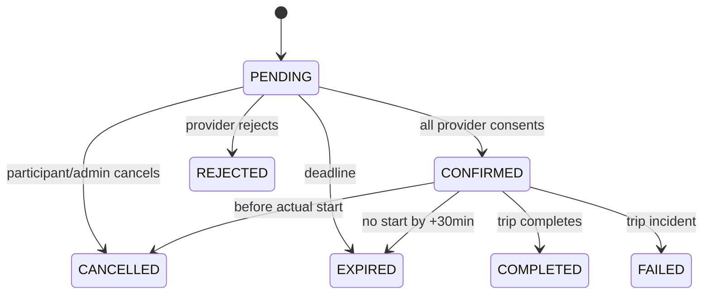

# 11 · Booking Lifecycle

Status: proposed implementation baseline; implementation requires separate human approval.

## Booking aggregate and trip are different state machines
A booking tracks agreement and resource allocation; a trip tracks performance. Create both with two reservations in one transaction: booking PENDING, trip SCHEDULED. Final consent -> booking CONFIRMED, trip ASSIGNED. Trip completion -> booking COMPLETED. No independent arbitrary booking status API.

| From -> to | Actor | Preconditions/action | Resource/event consequence |
|---|---|---|---|
| none->PENDING | Verified requester | Owned valid quote, service eligibility, shared availability; Idempotency-Key | Two holds, SCHEDULED history, booking.created to providers/requester |
| PENDING->PENDING | Required provider | ACCEPT before expiry with correct version; not all approved | Persist decision; booking.provider_decided to participants |
| PENDING->CONFIRMED | Last required provider | All consents, still active/approved resources, not expired | ASSIGNED trip/history; booking.confirmed and trip.assigned |
| PENDING->REJECTED | Required provider | REJECT with reason, active pending request | Release both, trip REJECTED; booking.rejected |
| PENDING->EXPIRED | Worker or command deadline guard | DB now>=expires_at; no late accept | Release both, trip EXPIRED; booking.expired |
| PENDING/CONFIRMED->CANCELLED | Requester/provider/admin | Before actual start; requester confirmed>=15min ahead, pending before deadline; providers reason mandatory | Release both, trip CANCELLED; booking.cancelled |
| CONFIRMED->EXPIRED | Worker/admin guard | ASSIGNED not started; now>starts_at+30min | Release both, trip EXPIRED; booking.expired |
| CONFIRMED->COMPLETED | Via trip transition | Driver/admin completes IN_TRANSIT | Release both; booking.completed; review eligible |
| CONFIRMED->FAILED | Via trip transition | STARTED/IN_TRANSIT incident with reason | Release only after operational failure resolution recorded; booking.failed and audit |

Invalid: accept by unrelated owner/driver; requester accepting hired provider consent; skipped confirmation; cancel completed; replacement after confirmed; terminal reopening; arbitrary total; late accept even when expiry worker stopped. Domain error409 carries no leaked conflict participant information.

## Shared trip lifecycle
| From -> to | Who | Required condition |
|---|---|---|
| none->SCHEDULED | Booking/draft service | Parent created; immutable history version1 |
| SCHEDULED->ASSIGNED | Consent/publish service | Booking fully approved or qualified host publishes |
| ASSIGNED->STARTED | Actual assigned driver/admin | Start window[-15min,+30min]; no active conflicting trip; all eligibility still valid |
| STARTED->IN_TRANSIT | Actual driver/admin | Expected version; event/history append |
| IN_TRANSIT->COMPLETED | Actual driver/admin | Expected version; no minimum simulated-distance proof; manual completion clearly labelled |
| SCHEDULED/ASSIGNED->CANCELLED,REJECTED,EXPIRED | Parent domain service | Exactly matching parent outcome; no terminal reopening |
| STARTED/IN_TRANSIT->FAILED | Driver/admin | Reason, incident audit and resource-safe resolution; no pretend completion |

All terminal states have no outgoing transition. Failure may also resolve ASSIGNED when admin records noncancelable operational incident; normal unstarted flow prefers CANCELLED/EXPIRED. Phase09 must choose exact exposed set: API transition accepts FAILED only STARTED/IN_TRANSIT; ASSIGNED uses parent cancellation. Each transition locks resources before aggregate/trip, checks version, appends unique history, syncs parent, writes outbox/audit in one transaction. System actor is explicitly WORKER, never fabricated human. Driver replacement pending changes trip driver snapshot and both scheduled reservation/decision versions in one commit; not a trip lifecycle advance.

## Manual simulation and overrun
Waypoints are manual textual labels, at most8; no coordinates, navigation or inferred live ETA. IN_TRANSIT may increment index one step with CAS; record progress audit/history separate event without duplicating status transition version keys. Every trip mutation increments version; waypoint event history can have fromStatus=toStatus=IN_TRANSIT and records index in safe metadata. Prior ongoing trip using vehicle/driver blocks a next STARTED even if scheduled intervals no longer overlap. Worker flags overrun after ends_at; no automatic physical release. Admin resolves conflicting upcoming schedule by cancel/rebook or pending driver replacement; fully confirmed vehicle changes require cancellation/new booking.

## Required evidence
Concurrent final consent vs cancellation/expiry; replayed transition; stale waypoint; next start during overrun; approval expiry between quote/accept/start; confirmation message exactly once per recipient. Read histories through participant-authorized endpoint. All service cancellation reasons persisted; no notification before commit.
