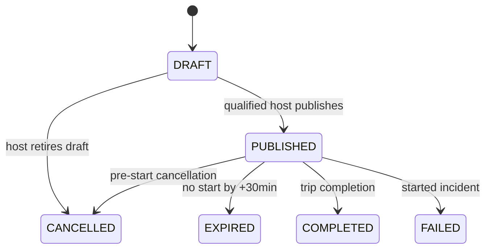

# 12 · Carpooling Lifecycle

Status: proposed implementation baseline; implementation requires separate human approval.

## Carpool aggregate

PUBLISHED includes fully booked rides; “Full” is a derived capacity label, not a competing lifecycle. A DRAFT has a SCHEDULED trip but no resource holds. Publishing -> trip ASSIGNED + two reservations. Started rides keep carpool PUBLISHED until completion/failure, but join/request/cancel policy checks trip state and cutoff. Departure passed cannot make new seats bookable.

## Seat request transitions
| From -> to | Actor | Conditions/counter effects | Event |
|---|---|---|---|
| none->PENDING | Passenger | APPROVAL mode, before15min cutoff; no counter change | seat.requested to host/requester |
| none->ACCEPTED | Passenger | INSTANT mode, enough seats; add seats | seat.accepted |
| PENDING->ACCEPTED | Host | Own ride, current version, before cutoff, enough seats; add seats | seat.accepted |
| PENDING->REJECTED | Host | Reason; no counter change | seat.rejected |
| PENDING->CANCELLED | Requester/admin | Before actual start; reason; no counter change | seat.cancelled |
| ACCEPTED->CANCELLED | Requester/admin | Requester>=15min ahead; admin pre-start override; subtract once | seat.cancelled |
| PENDING->EXPIRED | Worker | Join cutoff passed; no counter change | seat.expired |
| PENDING/ACCEPTED->CANCELLED | Ride cancellation service | Unstarted whole-ride cancellation; accepted sum removed atomically | carpool.cancelled to host+all live requesters |
| PENDING/ACCEPTED->EXPIRED | Unstarted expiry service | Ride never started by+30min; zero count and release both holds | carpool.expired |

ACCEPTED remains accepted after a completed/failed started ride to preserve participation/history and review eligibility for completion. Other terminal request states cannot reopen. A new request after cancelled/rejected/expired is allowed before cutoff using new key; partial live-request unique prevents simultaneous duplicate active requests.

## Concurrency algorithm (normative design)
Acquire relevant user rows per standard protocol. Lock carpool row FOR UPDATE, then existing request row if applicable. Re-read status, trip state, cutoff, user/host validity and version. For accept/instant join atomically `UPDATE carpools SET confirmed_seats=confirmed_seats+:n,version=version+1 WHERE id=:id AND confirmed_seats+:n<=seats_offered`, requiring one affected row; insert/transition request, persist outbox and idempotency result in same transaction. Bounds CHECK is second protection. If request creation/decision fails, rollback counter. For cancellation decrement only when prior locked status ACCEPTED; guarded write ensures nonnegative. Never read availability in React then trust it.

Race scenarios: two final-seat instant joins; two host accepts; accept versus passenger cancel; passenger cancel versus whole ride cancel; simultaneous repeated idempotency key; publish versus DriveHire booking; expired vehicle insurance versus publish/start. Use real PostgreSQL separate connections and barriers, not mocked Prisma responses.

## Search and privacy
Search requires exact manual city IDs, departure calendar date in origin city IANA timezone, positive seats and optional pagination. Convert local midnight boundaries to UTC; test DST city fixture even if initial catalogue India-only. Return PUBLISHED unstarted qualifying rides with available>=requested and before join cutoff. Origin/destination notes are manual and must not include promised navigation. Public detail excludes passenger roster/contact/private documents. Host sees accepted/pending request IDs and safe display names only; passengers see own request. No host invitation override of capacity.

## Cancellation and notifications
Whole-ride cancellation/expiry locks all child requests in stable UUID order, terminalizes parent/trip and requests, resets counter, releases both reservations and persists one typed event with recipient snapshot IDs. Notifications must preserve participants even after request status changes; worker must use event snapshot, not only current accepted query. Cutoff errors distinguish full/stale/closed request through safe code, never expose identities. No payment or refund status.
